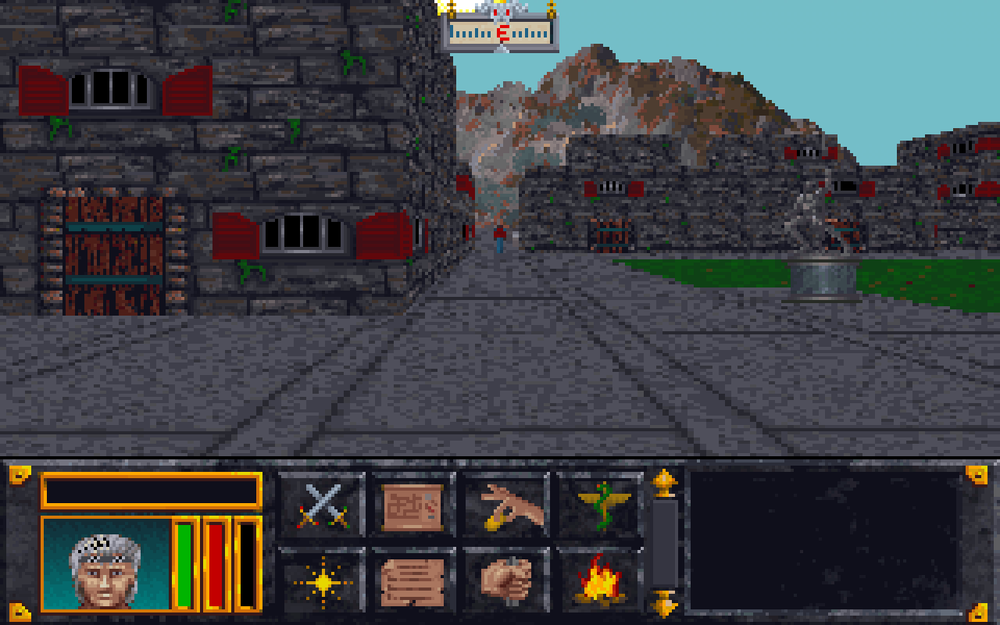

# tes-arena-rs

A routine-by-routine Rust port of The Elder Scrolls: Arena (ACD.EXE, CD
version 1.07), checked instruction for instruction against the original
running under an emulator, and a new wgpu front end (`view/`) that plays it.

The port keeps the original's behaviour exactly, bugs included: each ported
routine is compared with the original on thousands of generated cases, and
where the original faults or never returns, the port returns `None` rather
than guessing. A fixed mode (`src/fixes.rs`, off unless a front end asks)
corrects the catalogued bugs (docs/kept-bugs.md), each behind its own
switch; the view plays with it on unless given `--original`.

This is an unofficial fan project, not affiliated with or endorsed by
Bethesda Softworks or ZeniMax Media, who own The Elder Scrolls. You need
your own copy of the game (the CD version, 1.07) to run it.

## Your own game files

Nothing derived from the game is in this repository but the screenshot
above: no code, no data, no text, no saved games.

- The crate reads your own `ACD.EXE` at run time and unpacks it in memory
  (`src/exe.rs`: PKLITE 1.12 with extra compression).
- The view reads your game directory (GLOBAL.BSA, the loose files) at run
  time. Images, fonts, sounds, songs and texts are decoded there, never
  stored.
- `re/` (the unpacked image used for disassembly) is git-ignored, and so are
  the agent worktrees under `.claude/`.
- Test vectors hold only digests and the seeds that rebuild each case; texts
  the tests need are read from your files at run time.
- Never commit a saved game. Tests that need one read it from `ARENA_SAVE`.

By default the game is expected in `../ESarena` next to this directory.

## Building and running

    cargo build --release                  # the port, its examples
    cargo build --release -p arena-view    # the front end
    cargo test --release                   # the differential tests

`cargo build --examples` does not rebuild the `arena-view` binary; build it
with `cargo build --release` in `view/` (or `-p arena-view`).

### The view

    target/release/arena-view GAME_DIR [LEVEL] [options]

What to start with:

- `--create [SCRIPT]` — the program as the original starts: intro, title,
  main menu, then character creation on the original's screens (class by
  questions or from the list, name, gender, province on the map, what you
  are told, attributes and bonus points, face, the vision), then the start
  dungeon. SCRIPT feeds keys and clicks first (comma-separated: a
  character, `enter`, `esc`, `back`, `up`, `down`, `type:TEXT`,
  `click:X:Y`). The menu's Start plays the opening story; a key ends it and
  is spent, so give one (e.g. `esc`) after `S`.
- `--new-game CLASS:PROVINCE:SEX:FACE:NAME` — a character made without the
  screens (CLASS 0..17 from the class list, or `q` and ten answers 0..2),
  then the start dungeon. LEVEL may be left out (START.MIF).
- `LEVEL` — a `.MIF`, or a city: `CITY:PROVINCE:INDEX[:TERRAIN:WEATHER[:DAY]]`
  (province 0..7, 8 the Imperial City; index 0..7 city-states, 8..15
  towns, 16..31 villages; the weather is the season's roll, 5 rain with
  fog).
- `--load --save-dir DIR --slot N` — a saved game loaded at the start, into
  whatever area it was saved in. Your save folder is only read; saves the
  view makes (F5) go to `--save-dir`.

Options:

| Option | |
|---|---|
| `--original` | play the original's bugs as ACD.EXE has them; without it the view corrects the ones fixed so far (`src/fixes.rs`, docs/kept-bugs.md) |
| `--hour H` | the clock set to that hour of the first day |
| `--at COL ROW HEADING` | the player put in a square's centre (512 heading units a turn) |
| `--fight`, `--people` | a random encounter at the start; roll until people come |
| `--shot OUT.png [FRAMES [TURN]]` | render one picture headless and exit, after turning by TURN and FRAMES frames of walking |
| `--wait N`, `--click` | stand still N frames before the walk; click the view's centre first |
| `--do STEPS` | scripted steps before the shot (below) |
| `--picks A,B,..` | answers to the game's questions in order: a menu's entry by number, `tTEXT` typed text, `cX:Y` a click; after them a question is left as Esc leaves it |
| `--spellmaker SCRIPT` | with `--do spellmaker`: the spellmaker's clicks (`name`, `effects`, `target`, `element`, `new`, `buy`, `exit`, `up:I`, `down:I`, `done`, `show`, `pick:N`, `type:TEXT`) |
| `--playtest SEED FRAMES [SETUP]` | a headless playtest: a seeded random policy plays FRAMES turns and reports every turn that fails (`PT_TOURS=N`: N% of the turns given to targeted acts — doors, stairs, shops, errands, spells, items, dying and reloading; `PT_TRACE=1` names each turn on stderr) |
| `--bench TURNS [SETUP]` | the window's turns and redraws run headless and timed; `ARENA_PROFILE=1` adds named timers |
| `--mute`, `--no-music`, `--sound-log` | no sound at all; no music (no music driver loaded, as "No Music"); print each sound and song instead of or as well as playing it |

`--do` steps (comma-separated): `click`, `turn:N`, `walk:N`, `wait:N`,
`at:COL:ROW:HEADING`, `camp`, `save`, `load`, `key:N` (a key by scan code),
`ready`, `compass`, `swing:DX:DY` (a right-button drag; a swing needs 40h
mickeys or more), `cast:N`, `storm:N` (frames until the lightning flashes),
`inv`, `equip:N`, `select:N`, `drop`, `usable`, `use:N`, `spells`, `book`,
`spell:N`, `close`, `read` (the boxes read, as a key takes them), `clickat:X:Y`, `map`, `mapbtn:N` (the automap's
buttons), `sheet`, `page` (the sheet's equipment page), `log`, `nextpage`,
`bar:N` (the interface bar's button N), `travel`, `tclick:X:Y`, `tkey:K`
(the travel map), `shop:KIND`, `quest`, `mq` (the main quest's state
printed), `movie:NAME[:TEXT[:COLOUR]]`, `spellmaker`, `ui:TOKEN` (and
`ui:ms:N`); and debugging aids `give:N`, `learn:N`, `sp:N`, `gold:N`,
`hp:N`, `day:N`, `mday:N`, `material:N`, `wear:N`, `class:N`, `corpse`,
`fatigue:N`, `xp:N`. `view/src/main.rs` describes each where it parses
it.

Keys in the window are the original's. The game's menu keys (2542:0100,
asked in this order, one a frame; `src/menukeys.rs` runs them on the
engine):

| Key | What the original does |
|---|---|
| Esc | the options screen (sound, music, detail; New, Load, Save, Exit, Resume) |
| A | ready or put away the weapon (a right-button drag swings it) |
| C | the spellbook (unless barred) |
| P | arm picking pockets (the next click on someone) |
| S | the status box |
| U | the list of items to use |
| M | the automap (arrows and Home move it, a click places or edits a note); Shift+M the world map |
| F1 | cast the waiting touch spell on yourself, else the character sheet (N its equipment page) |
| F8 | the compass, shown or hidden |
| L | the logbook |
| R | camp |

Moving (2826:0473): Up/Down walk, Left/Right turn, Ctrl+Left/Right strafe,
J jumps (Shift: a running jump). The frame's own keys read the game's key
state as the original does: - and = the view's reach, F4 (5CA bit 2), N,
F2 and F3 (the position and the flash mode), and the debug combinations
(B+Q+X, Alt+F5, which wipes the quest's state). The interface bar's nine
buttons run the same handlers (the map button's right click is the world
map, the portrait is F1's).

The view's extras, on keys the game leaves alone: the mouse turns (click to
capture, Esc releases), Space jumps too, E or a captured click clicks the
view's centre, a captured right click (no drag) looks at it as the
original's right click does (a building named on the message line and
noted on the automap, 2826:0C15), the right button dragged swings the
weapon, Q readies the weapon as A does, I the inventory (a click
equips, a right click selects, D drops, U uses), K the character sheet
(without F1's touch cast), F5 quick-saves (not with Alt) and F9 loads the
--slot, F a random encounter, Shift+F people. Menus take arrows and Enter,
an entry's letter or number, a click, or the mouse wheel; Esc leaves them.
While the game waits for an answer no game time passes.

Sound plays through PulseAudio, opened at run time (nothing plays without
it). Music plays on an emulated OPL3 with the game's own timbres
(SAMPLE.AD), as its Sound Blaster FM driver did.

The `examples/` of both crates are smaller tools (maps of cities, dungeons
and the wilderness, the character sheet of a save, quests made in a town,
and so on); each one's header says how to run it. `view/examples/mainquest.rs`
walks the main quest through the game's own routines, from a new game and
from a copy of a save.

## How the port is verified

- `harness/emu.py` loads the unpacked image under unicorn (16-bit x86) at
  segment 1000h with a stub DOS. Every call starts from a defined register
  state, and a fault in the original is reported as a fault.
- Each `harness/gen_*.py` draws cases from a seeded stream: the memory a
  routine reads is filled, the original runs, and one line is written per
  case to `tests/vectors/*.txt`, with digests (FNV-1a) of every byte the
  routine changed, its registers, and what its stubbed callees were asked.
  "hang" and "fault" are recorded too.
- Each `tests/*.rs` rebuilds the same cases from the same seeds and replays
  them through the port: every digest must match. A port that returns `None`
  must do so exactly where the original hangs or faults.
- Each port is mutation-checked: small changes to the port (a boundary, a
  constant, a dropped write) must make its test fail. Cases are aimed at
  the edges random cases miss; random rolls can be forced to a value by
  running the RNG backwards (its multiplier 6D002Dh is invertible mod 2^32).
- The vectors are regenerated only when a port or its generator changes.
  Generators whose cases are independent shard: `python harness/par.py 6
  harness/gen_x.py ARGS OUT` runs six processes and joins their output in
  order (`emu.mine`), byte-identical to one process. `emu.changes` and
  `emu.fnv` (a small C function compiled on first use) keep generation
  fast. A few generators carry each case's state into the next
  (gen_cast.py, gen_missile.py) and must run in order on one process.
- `tools/regen_check.py` regenerates every vector file into a scratch
  directory (sharding where it can) and says, per generator, whether it
  reproduces the committed file byte for byte. Generators without a
  `Usage:` line take `ACD_unpacked.EXE OUT`. What it found identical is
  cached; gen_worldframes.py's output is cached case by case
  (`tools/casecache.py`), so adding or changing a case reruns only that
  case (the blocks are shared by every worktree, under git's common
  directory).

Running them:

    ARENA_EXE=/path/to/ACD.EXE ARENA_SAVE=/path/to/save cargo test --release
    python harness/gen_rules.py re/ACD_unpacked.EXE tests/vectors/rules.txt
    ARENA_SAVE=/path/to/save python tools/regen_check.py [NAME...]

`re/ACD_unpacked.EXE` is the unpacked image (`tools/` holds the unpacker and
`tools/rebuild_mz.py`). Generators need `pip install unicorn capstone`.

The tests that need the game read `ARENA_EXE` (or `../ESarena/ACD.EXE`) and
**skip silently** when it is missing; those that need a save read
`ARENA_SAVE`. In a git worktree `../ESarena` doesn't exist, so set both.

Beyond the vectors:

- `view/src/inputtest.rs` drives the window's input (`App::input`, `App::tick`)
  without a window and compares each action with the scripted path
  (`cargo test --release` in `view/`, with `ARENA_EXE` set).
- `--playtest` and `view/examples/mainquest.rs` play long sessions and the
  quest chain; they found the integration bugs the per-routine vectors
  can't (two ports meeting, the view's use of them).
- A port that gives up (`None`) between changing global state and
  restoring it must leave what the original's exit leaves (a bank mapped
  back, a seed, a nesting counter, a heap block freed): the original never
  takes that exit, so no vector shows it. Each such guard has a test that
  forces the `None`.
- `tools/coverage.py` builds the original's call graph and compares it with
  the addresses the port's docs name (`docs/COVERAGE.md`).

Porting a routine: disassemble it, port it with explicit 16-bit arithmetic
(`wrapping_*`, exact widths) and the original's bugs, keep state in memory
at the original's addresses where it isn't understood, write a generator and
a test, mutation-check it, then commit with a message saying what was
found. Some pitfalls the history taught:

- capstone prints 99h as `cdq` and 98h as `cwde`; in 16-bit code they are
  `cwd` and `cbw`.
- unicorn caches translated code: stub a callee with fixed code that reads
  its answer from data, don't patch code between cases.
- The image's RNG seed (and its table mode) make every roll the same; seed
  the machine before anything that rolls.
- DGROUP holds relocated segment words, which differ between the emulator
  and the port; convert them back before comparing.
- The port keeps the image at segment 0, so a hook into segment 0000 has a
  zero segment word; `Machine::hook_set` tests the whole far pointer.
- Loops the original only leaves when memory gives it what it looks for
  need a cheap bound (a cycle check), not a huge step limit.

## What is ported (`src/`)

Ported routines are methods on `Machine` (`machine.rs`: memory, the RNG, the
EMS banks, the mouse, sound and music drivers' state). Addresses are
image-relative segment:offset in the unpacked ACD.EXE.

- **Core:** `exe` (unpacking), `mem` (flat real-mode memory, the image at
  linear 0), `heap` (the game's heap), `random` (0000:6E10..6EEA), `dice`,
  `scale`, `format` (sprintf 0000:8D14), `hooks` (the segment-0000 hooks the
  3D mode installs, the indoor entry 0000:4767).
- **Files:** `bsa` (GLOBAL.BSA and loose files, 0000:67C4..6F87; files the
  game writes are kept in memory), `mif` (.MIF levels, the LZHUF
  decompressor, city blocks), `level` (0000:E87C), `info` (the .INF loader
  0000:EC03), `save`, `load` (25FD), `save_write` (25FD:0113),
  `automap` (0000:3491, 3503, 386F; 23F1:013C), `mapdraw` (the automap's
  squares, 0000:2F10), `mapnotes` (its notes, 0000:31FE..347F).
- **Characters and items:** `character`, `progression` (2686),
  `newgame` (creation, 1194:24A6..2D28, 222C; set-up 21EE:016C), `levelup`
  (1194:1034, exhaustion 2901:0014), `item`, `inventory`, `use_item`
  (24FA:07CD, 29CF:07C3, 1194:1AFB/7605/18F6), `loot`, `shop`, `outfit`,
  `names` (1194:080B), `effects` (2EBD), `rest` (1194:424E, 2901:016C),
  `status` (the bar's buttons and the status box, 2542, 2686:005E).
- **The world:** `engine` (the world loop 0000:A240), `frame` (0000:481E),
  `movement` (0000:F478..FD00), `controls` (2826:0002), `steps`
  (0000:FCF6), `squares` (0000:D3A0, 0628, 06BE), `click` (2826:077E),
  `trigger` (0000:43B1), `transit` (the outer loop 0000:0CAD, area runs,
  2294:025B), `city` (1194:0292), `cityinfo` (1194:3EBF), `dungeon`, `wild`
  (217B), `travel` (1194:2E69), `travelmap` (26F7: a destination and the
  journey), `mapscreen` (the travel map's screen, 2542:03DC, 26F7:0000),
  `clock` (0000:142D), `weather` (0000:0F05,
  2294:0B01), `light` (0000:B6EB, 0390), `sky` (2294:0341), `skyobj`
  (2294:08B9, 0A5D, 0000:E5C9), `celestial` (the stars, sun and moons,
  0000:E41A).
- **People and fights:** `actors` (0000:1854), `creature`, `encounter`
  (25CA, 1194:887A, 86F2, D91C), `combat`, `attack` (2AA1:00D8), `strike`
  (0000:3B6D), `weapon` (0000:38CE), `cast` (29CF:071F), `spell`
  (29CF:0941), `projectile` (29CF), `talk` (1194:DB6C), `text` (1194:A374,
  the `%` codes 2DA2:000A).
- **Shops and quests:** `shops` (the table at 869F; the temple 1194:C258),
  `tavern` (B93C), `store` (F48E, repairs C6AC), `guild` (A73E),
  `spellmaker` (1194:6064), `haggle` (1194:8020), `loot_window`
  (2433:0583), `piles` (2433:0000), `quest` (98E8..9CD7, 8F1E, CED7, D593),
  `sidequest` (1194:9358), `log`.
- **Sound:** `sound` (23BA:002A, 00E8), `music` (2294:04C0, 04F5, 10B6),
  `musicdrv` (2F9F:01BF, 001F, 0438, 000D, 1194:4943: the music driver's
  wrappers, compared with a driver loaded, harness/gen_musicplay.py).

## The front end (`view/`)

A new renderer, not a port of the original's drawing: the engine runs the
game and the view draws what is in its memory, through hooks for the
original's screens and questions.

- `world` (the level as triangles and billboards, the hit test), `render`
  and `shader.wgsl` (wgpu; the original's focal length, light rows and
  shading table), `flats` and `archive` (the game's images and files).
- `areas` (following the game from area to area), `newgame`, `create`
  (character creation's screens), `playtest`.
- `hud` (texts in the game's font), `dialog` (answers to the game's
  questions, by replaying a turn), `interface` (the bar, portrait, bars,
  compass, weapon, casting hands), `panels` (inventory, spellbook, loot),
  `doll` (the paper doll), `sheets` (the character sheet, the logbook, the
  bar's buttons), `automap`, `travel` (the travel and world maps), `shopui`,
  `questui`, `spellmaker`.
- `flc` (the game's FLC animations), `audio` (VOC sounds through
  PulseAudio), `music` (XMIDI on an emulated OPL3).
- `inputtest` (the window's input tested headless), `bench` and `prof`
  (timing).

## How much is ported

`docs/COVERAGE.md` (made by `tools/coverage.py`) counts the original's
reachable routines against the addresses the port names. At the time of
writing: 2537 reachable routines (198,167 bytes); 2202 ported in whole or
part (176,634 bytes), counting far thunks to ported code, the handlers
the port dispatches on by their offsets, and the routines read by hand as
trivial or inlined (`tools/triage.tsv`); 30 left to the front end as hooks
and 47 that the view re-implements; 230 presentation, I/O, driver or
hardware routines not ported (the renderer's deferred lists, the menu
library's remains, the window library's keys and buttons, input waits,
the sound and CyberMan drivers, the EMS driver's and the joystick's
calls, decode artefacts); 28 game-state or undetermined routines not
covered by an address (1 of them open, 12 bytes: 1194:0FFB, read by hand
as part of 0F08; the rest likely ported inside their callers). Every indirect call site is followed or
explained: the ones no table or pointer heuristic resolves were traced by
hand (`INDIRECT` in the tool), 15 with no target in the image (window
callbacks, code generated at run time, a chained interrupt, a return).

## Known gaps and approximations

At the time of writing:

- **Not tested by hand:** the live window has never been driven by a
  person. Its input paths are tested headlessly (`inputtest`) and
  everything else through scripted shots, playtests and the walkthrough.
- **Engine:**
  - Two text codes give `None` as the original's own fault, the only
    text paths left: `%qf` seeds a name with an EBX high word left over
    from earlier code (no text uses it), and `%en` outside an equipment
    store returns into 2DA2 at the text's offset (townspeople's lines use
    it in the street). Two of the text vectors' cases survive that return
    by reading on from FFFD:0001, the BIOS ROM's last bytes; they are
    counted, not compared.
  - The staff walkthrough (`mainquest GAME_DIR STAFF:CITY:3:3 9`) runs
    from a new game through the eight pieces, the Emperor's audience, the
    palace's piece and the staff made whole (1194:D986), and is back in
    the Imperial City; it travels, places the player and changes levels
    rather than walking.
- **Bounds where the original never ends:** a respawn with no free square
  gives up after 65536 tries; collapsing from exhaustion inside the hour it
  costs gives up after 200 nested collapses.
- **View:**
  - The view's own guess at the squares the drawing reaches
    (`world::creature_flats_seen`) is kept only for when the engine has no
    page; in play the ported renderer always draws (render-gaps' sweep: no
    fallback in 112,955 frames), so the ray caster's own squares are used.
  - Only the view's own GPU world (`--gpu-world`, or no page): a spell's
    burst is nudged in front of the wall it hits (the depth buffer would
    hide it; the original draws a square's objects over its walls), and a
    door's faces never hide lights behind them (the original's swinging
    face only, CCF8 FFFFh). Its lights behind walls otherwise follow
    0000:B7A9, kinds 0Ah and 0Dh's faces excepted as there. The ported
    renderer has the rule and both exceptions exactly (`playdiagonal`,
    `playdoormoving`, and the exact 3D views of the night street and the
    dungeons).
  - The sun and the helmet's head recolour are ported but not yet seen on
    screen.
  - The travel map's texts take the province picture's palette. Its
    passes and the journey's days go a game tick each: the original's loop
    never waits (no retrace or timer read), so they run as fast as the
    machine, and the view's tick is its own pace. The fades on either
    side of the days are the original's, retrace by retrace.
  - Fonts are each screen's own as its routine selects them (B036 set
    through 0000:9AE6); no text in the game's files switches font inline
    (0Ch), so that path isn't drawn.
  - The shops' screen (MENUSCRN.IMG and the name's banner, 1194:4B60,
    4BFF) is drawn behind their questions, with the pictures 4B8E puts
    on it (the haggles' NEGOTBUT and YESNO, the temple's and the
    repairs' YESNO, the guild's and the tavern's).
- **Sound:** the music runs the game's own FM driver ported (its register
  writes the original's); it has not been listened to by a person, and
  there is no SoundFont fallback.

## License

MIT (LICENSE). The license covers this repository's code only; the game
and its files stay Bethesda's, and the third-party code below keeps its own
license.

## Third-party code

The `arena` crate has no dependencies. The view uses:

| Crate | Licence |
|---|---|
| wgpu | MIT OR Apache-2.0 |
| winit | Apache-2.0 |
| pollster | Apache-2.0 / MIT |
| bytemuck | Zlib OR Apache-2.0 OR MIT |
| glam | MIT OR Apache-2.0 |
| png | MIT OR Apache-2.0 |
| libloading | ISC |
| nuked-opl3 | LGPL-2.1-or-later |

`nuked-opl3` (a Rust port of Nuked-OPL3) is linked statically into the
`arena-view` binary. That matters only if you distribute the binary: the
LGPL then asks that users can relink it against a modified version of the
library (for example by providing the object files or the source).
